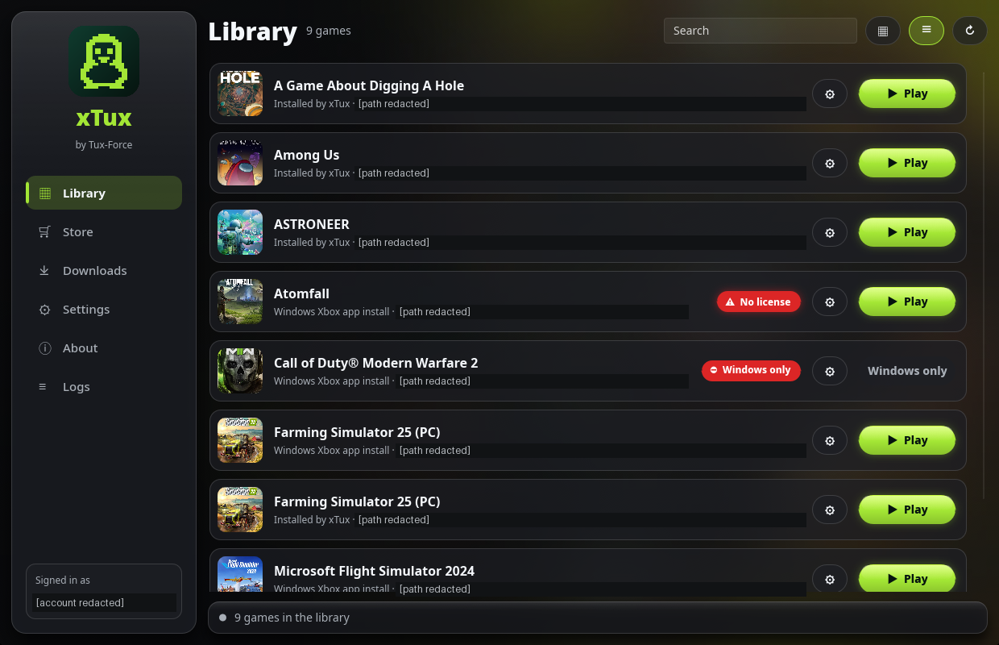
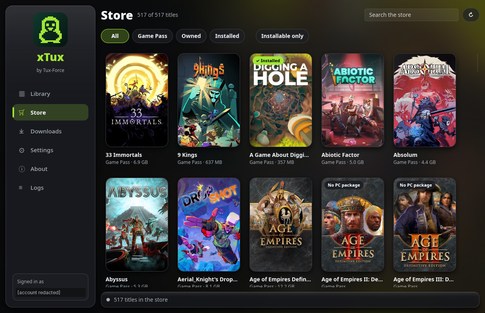
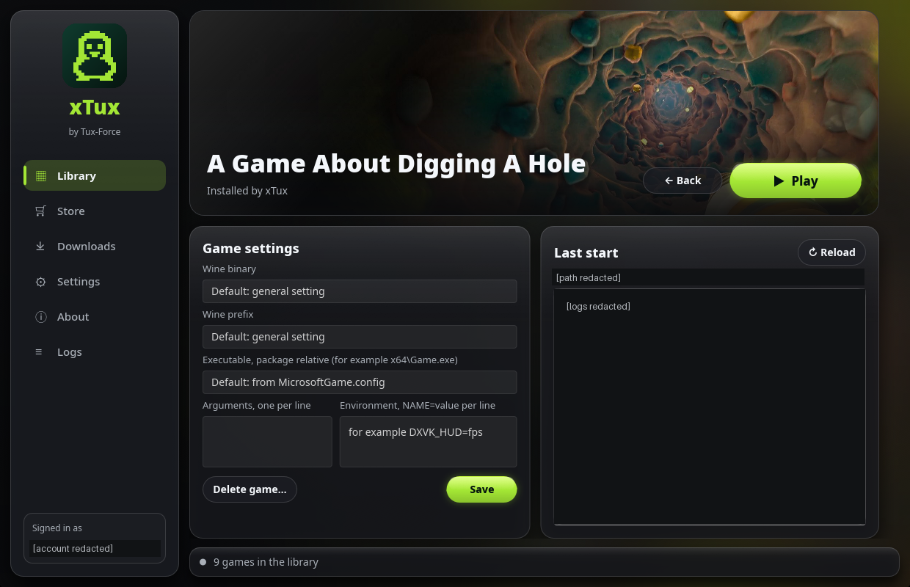

<p align="center">
  <picture>
    <source media="(prefers-color-scheme: dark)" srcset="https://tux-force.github.io/brand/logo-horizontal-dark-bg.png" />
    
  </picture>
</p>

<h1 align="center">xTux</h1>
<p align="center">Play the PC games you own or subscribe to on Linux — with real licenses, no cracks.</p>
<p align="center"><a href="https://tux-force.github.io">Website</a> · <a href="https://github.com/Tux-Force">Tux-Force</a> · soft fork of <a href="https://github.com/xodus-gaming/xodus">Xodus</a></p>

> [!CAUTION]
> This is an unofficial community project - use at your own risk. It is not affiliated with, endorsed by, or sponsored
> by Microsoft or Xbox; all trademarks, product names, and company names or logos mentioned herein are the property
> of their respective owners.

## What is xTux?

xTux is the core of [Tux-Force](https://github.com/Tux-Force): it signs you in with your Microsoft account, fetches
licenses from the Microsoft licensing service, downloads or reuses game packages and starts GDK games in Wine.
Only games your account is entitled to run; there is no license bypass.

xTux is a **soft fork of [Xodus](https://github.com/xodus-gaming/xodus)** by the xodus-gaming community. Everything
here builds on their work. We pull in new upstream code when it is useful; otherwise xTux develops independently
to move faster on everything a complete Linux experience needs. Tux-Force is built with AI and welcomes AI-assisted
contributions (see [CONTRIBUTING](https://github.com/Tux-Force/.github/blob/main/CONTRIBUTING.md)).

### What xTux adds on top of Xodus

- **One install format:** xTux reads and writes the layout of the Windows Xbox app (`Content/` plus the package
  header named by its content id), so `xtux-cli run` starts games straight from a Windows installation (dual boot,
  NTFS) without a second download. `xtux-cli migrate <folder>` moves an older Xodus install into that layout.
- **Bridge for GDK services:** `run` starts a loopback service with a per-run secret that answers what the game's
  xgameruntime needs from Microsoft without handing account tokens to the game:
  - store license tokens (`XStoreQueryLicenseToken`),
  - title-bound, signed Xbox Live tokens (device, title and user token, as on Windows), with relying parties from the
    title's own endpoint table.
- **Game start fixes:** software video decoders for intro videos, identity and license state for xgameruntime,
  games whose entry executable is not encrypted, the Windows package identity for games depending on the Windows App
  Runtime, and the GameInput redistributable a game ships (installed into the prefix at launch). Minecraft for
  Windows runs this way.
- **Controllers:** PlayStation controllers (DualShock 4, DualSense, DualSense Edge) reach games as Xbox gamepads by
  default, the kind XInput and GameInput games understand; per game they can stay PlayStation controllers.
- **Merged upstream pull requests** that are not in Xodus `main` yet (#216, #237, #242, #243, #217, #212, #197, #215).

The matching runtime and Wine changes live in [Tux-Force/xgameruntime](https://github.com/Tux-Force/xgameruntime)
and [Tux-Force/wine](https://github.com/Tux-Force/wine).

## Using xTux

Guides, the compatibility list and downloads are on the website, **https://tux-force.github.io**:

- [Quick start](https://tux-force.github.io/guide/quick-start/) and [installation](https://tux-force.github.io/guide/installation/)
- [Running games](https://tux-force.github.io/guide/running-games/): `xtux-cli list`, `run` by name, Windows installs, `migrate`
- [Sign-in and password prompts](https://tux-force.github.io/guide/sign-in/), [troubleshooting](https://tux-force.github.io/guide/troubleshooting/)
- [Compatibility](https://tux-force.github.io/compatibility/) and [architecture](https://tux-force.github.io/project/architecture/)

`xtux-cli --help` lists all commands. The command line tool is **xTux-cli** (`xtux-cli`), the daemon **xTux-service**
(`xtux-service`) and the graphical front end the **xTux Launcher** (`xtux-launcher`); the core library keeps its
upstream name `xodus`.

## Launcher features

The current source includes a searchable local library (grid or list), Play/Stop, per-game Wine/prefix/executable/
arguments/environment settings, launch logs and file-based anti-cheat indicators. The Store combines PC Game Pass
and owned-title catalogs with filters, artwork, title details and screenshot galleries.

Supported packages can be installed through a persistent service-owned download queue with pause/resume,
reordering and activity graphs. The CLI shares it via `xtux-cli downloads`. Catalog presence does not establish
an entitlement; Microsoft checks the license when the game starts.

The Updates page checks installed games and DLCs, including Windows Xbox app installs, and updates them in place;
`xtux-cli verify` checks an install against its package (see [Game and DLC updates](docs/Updates.md)). When a game
ends abnormally, the launcher names the cause and a hint, with a button to open the log.

**Delete game…** removes the entire game folder after confirmation, including Windows Xbox app installs and any
saves inside that folder.

On the first start the launcher opens **Welcome to xTux**: "Set everything up" signs in, downloads the
[Tux-Force Wine](https://github.com/Tux-Force/wine/releases) (checked against its SHA-256 file), prepares the prefix
and finds the game folders. `xtux-cli` without a command shows the same state with a menu and runs the setup in
the terminal. Releases also come as a Flatpak (`xtux-linux-x86_64.flatpak`), which brings WebKitGTK for the sign-in.
See [Setup](docs/Setup.md).

Global and per-game settings share `$XDG_CONFIG_HOME/xtux/settings.toml` (normally `~/.config/xtux/settings.toml`).
Per-game overrides are keyed by game folder. `controller = "xbox"` (default) or `"native"` sets how PlayStation
controllers reach games; games of one prefix share the mode, so a change applies once they are all closed. See the [launcher guide](https://tux-force.github.io/guide/launcher/)
for pages, launch options, appearance settings and log locations.

## Launcher screenshots

The xTux Launcher brings your installed games and the Store catalog into one graphical interface.
Account details and personal paths are redacted in these screenshots.

### Library



### Store



### Game details



[Download branded social-media versions](docs/social-media/README.md) of all three screenshots.

## Building

The project structure is as follows.

```
.
├── msixvc / msixvc-common - MSIXVC and XSP package utilities
├── xodus - authentication, tokens and Microsoft API abstractions
├── xtux-games - game layouts, catalog, install queue, prefix setup, launch and bridge logic
├── xtux-protocol - typed requests, responses and events for service protocol v2
├── xtux-cli - command line client
├── xtux-service - daemon owning accounts, downloads and game launches
└── xtux-launcher - Slint graphical client
```

> [!NOTE]
> xtux-service is the integration point for game operations. CLI and launcher use its `XTX2` length-prefixed JSON
> protocol; the older runtime XML messages are still supported on the same socket.

### Prerequisites

- Rust version 1.98 or later
- Right now CLI relies on wry and tao to show a login page. Consult https://docs.rs/wry/latest/wry/#platform-considerations
  (the Flatpak, `packaging/flatpak`, gets WebKitGTK from the GNOME runtime)
- xtux-service relies on `protoc` to compile `proto/` definitions make sure to install it for your platform

### Running

Building all crates in release mode

```bash
cargo build --release --workspace
```

Running cli in debug

```
cargo run --bin xtux-cli -- --help
```

Running xtux-service in debug

```
cargo run --bin xtux-service
```

Running the launcher in debug

```bash
cargo run --bin xtux-launcher
```

Debug and profile `xtux-cli` or `xtux-service` with [tokio-console](https://github.com/tokio-rs/console)

```
RUSTFLAGS="--cfg tokio_unstable" cargo run --bin xtux-cli --features tokio_console
```

> [!WARNING]
> For better performance when decrypting MSIXVC files, the `aes` and `ssse3` features are enabled on `x86_64`,
> and the `aes` feature is enabled on `aarch64`. This means that the program will crash with an illegal instruction
> error when running on a CPU which doesn't support those instructions.
>
> See https://en.wikipedia.org/wiki/AES_instruction_set for a list of compatible CPUs (every processor from
> 2011 onwards should be supported).

## Releases

Work lands in `develop` through pull requests (`feature/*`, `fix/*`, `chore/*`), merged only when CI is green.
`main` is protected and holds released code. A release goes like this:

1. Set the version in `crates/xtux-cli/Cargo.toml` and add `docs/ReleaseNotes-v<version>.md` (in a PR to `develop`).
2. Merge `develop` into `main` with a pull request.
3. Tag the merge commit on `main` with `v<version>` and push the tag.

The CI builds, tests and checks licenses for the tag, then publishes the GitHub release with the CI-built archives
and checksums. It refuses tags on commits that are not on `main` and tags that do not match the version.
Versions `0.x` and versions with a suffix (`-rc1`) are marked as pre-releases.

## License

xTux is free software under the GNU General Public License 3.0 ([LICENSE](LICENSE)); the crates taken over from
Xodus are `GPL-3.0-only`, the new xTux crates `GPL-3.0-or-later`. The licenses of all dependencies are listed in
[licenses/THIRD-PARTY-LICENSES.md](licenses/THIRD-PARTY-LICENSES.md) (generated with `scripts/third-party-licenses.sh`,
shipped with every release and shown on the launcher's About page). The CI checks with `cargo deny` (`deny.toml`)
that every dependency has a GPL-3.0 compatible license and comes from a known source. More on the website:
[Licenses](https://tux-force.github.io/project/licenses/).

## Special Thanks

- The [Xodus](https://github.com/xodus-gaming/xodus) team and contributors, on whose work xTux is built

- [XvdTool.Streaming](https://github.com/LukeFZ/XvdTool.Streaming) and [CikExtractor](https://github.com/LukeFZ/CikExtractor) by LukeFZ
